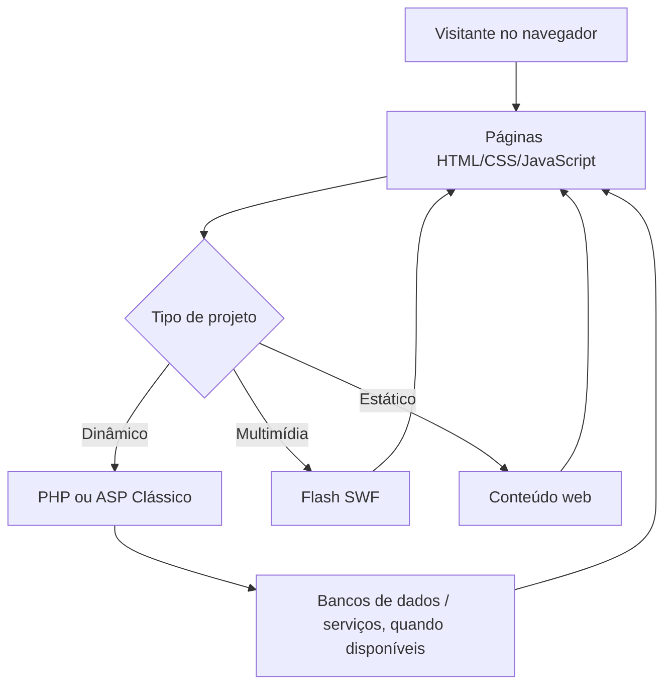
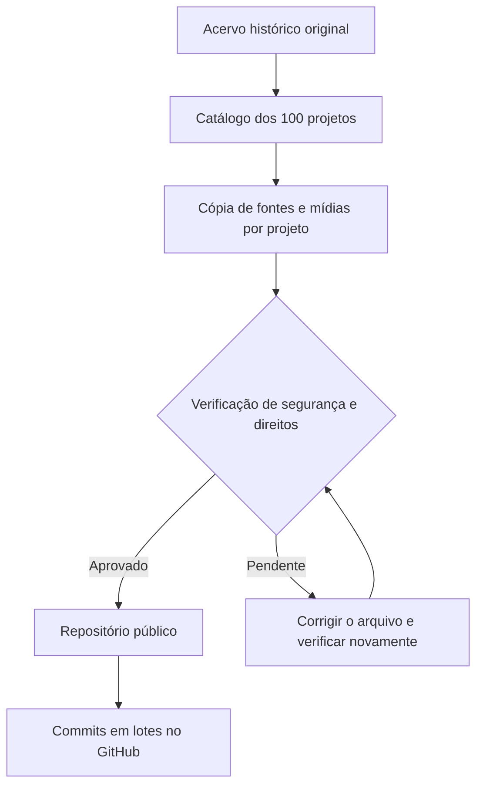

# PHP-Projects-Portfolio

**Acervo histórico de sites, aplicações PHP e projetos web desenvolvidos entre 2003 e 2011.**

Este repositório documenta a trajetória de desenvolvimento da Casa da Web e organiza as pastas originais do acervo. Há projetos com PHP, ASP, HTML, CSS, JavaScript e Flash. As implementações históricas foram feitas para ambientes e versões de software da época.

> **Publicação:** este repositório reúne o catálogo de 100 pastas de projetos e foi preparado para receber os fontes históricos em `projetos/<nome>/src/`. O script `ferramentas/montar_portfolio_php_publico.py` incorpora os códigos e recursos que passam pela triagem. Arquivos que podem expor credenciais, dados pessoais ou backups exigem ajuste antes de serem publicados. Não é necessário criar repositório privado.

## Dimensão do acervo original

| Indicador | Quantidade |
|---|---:|
| Pastas de primeiro nível | 100 |
| Arquivos | 46.919 |
| PHP | 13.436 |
| ASP | 390 |
| Flash SWF | 570 |
| Flash FLA | 446 |
| Tamanho total descompactado | ~2,06 GiB |
| Pacotes originais analisados | 8 ZIPs |

## Principais tecnologias

PHP · HTML · CSS · JavaScript · ASP Clássico · Flash (SWF/FLA) · bibliotecas e ferramentas legadas presentes nos projetos.

## Visão histórica das arquiteturas

Esta é uma visão **geral de tecnologias encontradas**, não um diagrama que represente necessariamente cada um dos projetos.

## Catálogo de projetos

Os nomes das pastas foram preservados para facilitar a localização das versões históricas. **Indicadores funcionais são preliminares**, obtidos dos nomes dos arquivos; a confirmação depende de inspecionar os sistemas.

| Projeto | Arquivos | Tecnologias detectadas | Indícios de módulos |
|---|---:|---|---|
| [angratel](projetos/angratel/README.md) | 138 | PHP, CSS, JavaScript | Área administrativa; Autenticação de usuários; Galerias ou fotos |
| [bakof](projetos/bakof/README.md) | 479 | PHP, HTML, CSS, JavaScript, Flash SWF | Galerias ou fotos; Catálogo ou produtos; Publicação de notícias; Enquetes |
| [bvfinanceira](projetos/bvfinanceira/README.md) | 13 | PHP, CSS | Cadastro e formulários |
| [catalog](projetos/catalog/README.md) | 415 | PHP, CSS, JavaScript | Publicação de notícias; Pedidos ou carrinho; Autenticação de usuários; Área administrativa |
| [cinetica](projetos/cinetica/README.md) | 347 | PHP, CSS, JavaScript, Flash SWF, Flash FLA | Galerias ou fotos; Publicação de notícias; Catálogo ou produtos; Enquetes |
| [comercio](projetos/comercio/README.md) | 215 | PHP, CSS, JavaScript, Flash SWF, Flash FLA | Enquetes; Catálogo ou produtos; Pedidos ou carrinho; Cadastro e formulários |
| [daluz](projetos/daluz/README.md) | 501 | PHP, HTML, CSS, JavaScript, Flash SWF | Galerias ou fotos; Catálogo ou produtos; Publicação de notícias; Enquetes |
| [didomenico](projetos/didomenico/README.md) | 378 | PHP, HTML, CSS, JavaScript, Flash SWF | Galerias ou fotos; Catálogo ou produtos; Publicação de notícias; Enquetes |
| [ecco](projetos/ecco/README.md) | 828 | PHP, HTML, CSS, JavaScript, Flash SWF | Conteúdo/recursos de site histórico (funções a confirmar) |
| [fida](projetos/fida/README.md) | 75 | PHP, CSS, JavaScript, Flash SWF, Flash FLA | Conteúdo/recursos de site histórico (funções a confirmar) |
| [floreste](projetos/floreste/README.md) | 101 | PHP, HTML, CSS, JavaScript, Flash SWF | Catálogo ou produtos; Contato e mensagens |
| [folhadonoroeste](projetos/folhadonoroeste/README.md) | 128 | PHP, CSS, JavaScript, Flash SWF, Flash FLA | Relatórios |
| [folhanoroeste 2.0](projetos/folhanoroeste%202.0/README.md) | 748 | PHP, ASP Clássico, HTML, CSS, JavaScript | Enquetes; Galerias ou fotos; Publicação de notícias; Cadastro e formulários |
| [fredericoluz](projetos/fredericoluz/README.md) | 1,831 | PHP, ASP Clássico, HTML, CSS, JavaScript | Área administrativa; Enquetes; Contato e mensagens; Autenticação de usuários |
| [frogstore](projetos/frogstore/README.md) | 3 | A verificar | Conteúdo/recursos de site histórico (funções a confirmar) |
| [fuga](projetos/fuga/README.md) | 1 | A verificar | Conteúdo/recursos de site histórico (funções a confirmar) |
| [garopaba](projetos/garopaba/README.md) | 1,964 | PHP, ASP Clássico, HTML, CSS, JavaScript | Área administrativa; Reservas ou agenda; Enquetes; Publicação de notícias |
| [helen](projetos/helen/README.md) | 1 | A verificar | Conteúdo/recursos de site histórico (funções a confirmar) |
| [holz](projetos/holz/README.md) | 41 | PHP, CSS, JavaScript, Flash SWF, Flash FLA | Conteúdo/recursos de site histórico (funções a confirmar) |
| [intruder](projetos/intruder/README.md) | 2,557 | PHP, ASP Clássico, HTML, CSS, JavaScript | Área administrativa; Áudio e streaming; Enquetes; Contato e mensagens |
| [intruder 2.0](projetos/intruder%202.0/README.md) | 5,202 | PHP, ASP Clássico, HTML, CSS, JavaScript | Área administrativa; Galerias ou fotos; Enquetes; Reservas ou agenda |
| [jornaladelar](projetos/jornaladelar/README.md) | 879 | PHP, ASP Clássico, HTML, CSS, JavaScript | Área administrativa; Autenticação de usuários; Publicação de notícias |
| [jornalfred](projetos/jornalfred/README.md) | 42 | PHP, HTML, CSS, JavaScript, Flash SWF | Publicação de notícias; Galerias ou fotos; Contato e mensagens |
| [juridico](projetos/juridico/README.md) | 849 | PHP, ASP Clássico, HTML, CSS, JavaScript | Área administrativa; Relatórios; Áudio e streaming |
| [labucha](projetos/labucha/README.md) | 2,772 | PHP, ASP Clássico, HTML, CSS, JavaScript | Área administrativa; Enquetes; Autenticação de usuários; Publicação de notícias |
| [lober](projetos/lober/README.md) | 1 | A verificar | Conteúdo/recursos de site histórico (funções a confirmar) |
| [loja](projetos/loja/README.md) | 2,606 | PHP, HTML, CSS, JavaScript, Flash SWF | Áudio e streaming; Galerias ou fotos; Publicação de notícias; Autenticação de usuários |
| [luzealegria](projetos/luzealegria/README.md) | 6 | PHP | Conteúdo/recursos de site histórico (funções a confirmar) |
| [masteraltofalantes](projetos/masteraltofalantes/README.md) | 41 | PHP, HTML | Catálogo ou produtos; Galerias ou fotos; Contato e mensagens; Pedidos ou carrinho |
| [minicurso](projetos/minicurso/README.md) | 30 | PHP, CSS, JavaScript | Catálogo ou produtos; Cadastro e formulários |
| [mitra](projetos/mitra/README.md) | 310 | PHP, ASP Clássico, HTML, CSS, JavaScript | Área administrativa; Contato e mensagens; Publicação de notícias |
| [moduloadministrador](projetos/moduloadministrador/README.md) | 74 | PHP, HTML, CSS, JavaScript, Flash SWF | Conteúdo/recursos de site histórico (funções a confirmar) |
| [ms](projetos/ms/README.md) | 376 | PHP, HTML, CSS, JavaScript, Flash SWF | Catálogo ou produtos; Galerias ou fotos; Publicação de notícias; Enquetes |
| [multixmarcas](projetos/multixmarcas/README.md) | 1,395 | PHP, HTML, CSS, JavaScript, Flash SWF | Pedidos ou carrinho; Galerias ou fotos; Catálogo ou produtos; Publicação de notícias |
| [nativa](projetos/nativa/README.md) | 471 | PHP, HTML, CSS, Flash SWF, Flash FLA | Área administrativa; Reservas ou agenda; Publicação de notícias; Contato e mensagens |
| [netmax](projetos/netmax/README.md) | 1 | A verificar | Conteúdo/recursos de site histórico (funções a confirmar) |
| [osti](projetos/osti/README.md) | 722 | PHP, ASP Clássico, HTML, CSS, JavaScript | Área administrativa; Relatórios; Áudio e streaming |
| [palace](projetos/palace/README.md) | 212 | PHP, ASP Clássico, HTML, CSS, JavaScript | Contato e mensagens |
| [palacehotel](projetos/palacehotel/README.md) | 352 | PHP, HTML, CSS, JavaScript, Flash SWF | Contato e mensagens; Reservas ou agenda |
| [peron](projetos/peron/README.md) | 26 | PHP, HTML, CSS, JavaScript, Flash SWF | Contato e mensagens |
| [pfcaicara](projetos/pfcaicara/README.md) | 793 | PHP, HTML, CSS, JavaScript, Flash SWF | Galerias ou fotos; Publicação de notícias; Catálogo ou produtos; Enquetes |
| [pfpalmitinho](projetos/pfpalmitinho/README.md) | 102 | PHP, HTML, CSS, JavaScript, Flash SWF | Publicação de notícias; Contato e mensagens |
| [pfplanalto](projetos/pfplanalto/README.md) | 981 | PHP, HTML, CSS, JavaScript, Flash SWF | Galerias ou fotos; Publicação de notícias; Catálogo ou produtos; Enquetes |
| [philipe](projetos/philipe/README.md) | 26 | PHP, CSS, JavaScript, Flash SWF, Flash FLA | Cadastro e formulários |
| [piaia](projetos/piaia/README.md) | 25 | PHP, HTML, Flash SWF, Flash FLA | Contato e mensagens; Pedidos ou carrinho |
| [pmotos](projetos/pmotos/README.md) | 94 | PHP, HTML, CSS, JavaScript, Flash FLA | Catálogo ou produtos; Galerias ou fotos; Contato e mensagens |
| [postoseberi](projetos/postoseberi/README.md) | 1,437 | PHP, ASP Clássico, HTML, CSS, JavaScript | Galerias ou fotos; Publicação de notícias; Relatórios; Áudio e streaming |
| [prefeitura](projetos/prefeitura/README.md) | 62 | PHP, CSS, JavaScript, Flash SWF, Flash FLA | Autenticação de usuários; Publicação de notícias |
| [pronatepe](projetos/pronatepe/README.md) | 7 | PHP, Flash SWF, Flash FLA | Conteúdo/recursos de site histórico (funções a confirmar) |
| [provedor](projetos/provedor/README.md) | 194 | PHP, HTML, CSS, JavaScript, Flash SWF | Galerias ou fotos; Contato e mensagens |
| [radiocultura](projetos/radiocultura/README.md) | 333 | PHP, HTML, CSS, JavaScript, Flash SWF | Galerias ou fotos; Enquetes; Contato e mensagens; Publicação de notícias |
| [radionovo](projetos/radionovo/README.md) | 1,690 | PHP, ASP Clássico, HTML, CSS, JavaScript | Galerias ou fotos; Área administrativa; Áudio e streaming; Autenticação de usuários |
| [radiosol](projetos/radiosol/README.md) | 42 | PHP, HTML, JavaScript, Flash SWF | Enquetes; Áudio e streaming; Publicação de notícias |
| [radiovistaalegre](projetos/radiovistaalegre/README.md) | 4 | PHP | Conteúdo/recursos de site histórico (funções a confirmar) |
| [radioxiru](projetos/radioxiru/README.md) | 763 | PHP, ASP Clássico, HTML, CSS, JavaScript | Enquetes; Área administrativa; Contato e mensagens; Autenticação de usuários |
| [real](projetos/real/README.md) | 115 | PHP, HTML | Conteúdo/recursos de site histórico (funções a confirmar) |
| [reginaldo](projetos/reginaldo/README.md) | 138 | PHP, HTML, CSS, JavaScript, Flash SWF | Galerias ou fotos |
| [renascer](projetos/renascer/README.md) | 21 | PHP, JavaScript, Flash SWF, Flash FLA | Conteúdo/recursos de site histórico (funções a confirmar) |
| [riboli](projetos/riboli/README.md) | 260 | PHP, HTML, CSS, JavaScript, Flash FLA | Contato e mensagens; Autenticação de usuários; Galerias ou fotos |
| [rolmac](projetos/rolmac/README.md) | 1,018 | PHP, HTML, CSS, JavaScript, Flash SWF | Galerias ou fotos; Catálogo ou produtos; Publicação de notícias; Enquetes |
| [rolmac 2.0](projetos/rolmac%202.0/README.md) | 17 | PHP, CSS, JavaScript, Flash FLA | Conteúdo/recursos de site histórico (funções a confirmar) |
| [romitti](projetos/romitti/README.md) | 34 | PHP, HTML, JavaScript | Catálogo ou produtos; Contato e mensagens; Galerias ou fotos |
| [rosanegra](projetos/rosanegra/README.md) | 3 | A verificar | Conteúdo/recursos de site histórico (funções a confirmar) |
| [saoluiz](projetos/saoluiz/README.md) | 121 | PHP, CSS, JavaScript, Flash SWF, Flash FLA | Contato e mensagens |
| [seberieventos](projetos/seberieventos/README.md) | 43 | PHP | Galerias ou fotos; Reservas ou agenda; Contato e mensagens |
| [semtur](projetos/semtur/README.md) | 281 | PHP, HTML, CSS, Flash SWF, Flash FLA | Reservas ou agenda; Publicação de notícias; Área administrativa; Contato e mensagens |
| [sergiovoip](projetos/sergiovoip/README.md) | 57 | CSS, JavaScript | Conteúdo/recursos de site histórico (funções a confirmar) |
| [simplecast](projetos/simplecast/README.md) | 2 | A verificar | Conteúdo/recursos de site histórico (funções a confirmar) |
| [sol](projetos/sol/README.md) | 98 | PHP, JavaScript, Flash SWF | Áudio e streaming; Enquetes |
| [sollucao](projetos/sollucao/README.md) | 116 | PHP, CSS, JavaScript, Flash SWF, Flash FLA | Galerias ou fotos |
| [spazio](projetos/spazio/README.md) | 109 | PHP, CSS, JavaScript, Flash SWF, Flash FLA | Galerias ou fotos; Publicação de notícias; Áudio e streaming; Contato e mensagens |
| [sscolor](projetos/sscolor/README.md) | 7 | PHP, Flash SWF, Flash FLA | Conteúdo/recursos de site histórico (funções a confirmar) |
| [stangler](projetos/stangler/README.md) | 5 | PHP | Conteúdo/recursos de site histórico (funções a confirmar) |
| [star](projetos/star/README.md) | 59 | PHP, HTML, CSS, JavaScript | Reservas ou agenda; Galerias ou fotos; Contato e mensagens |
| [sunshine](projetos/sunshine/README.md) | 15 | Flash FLA | Conteúdo/recursos de site histórico (funções a confirmar) |
| [superlig](projetos/superlig/README.md) | 33 | PHP, CSS, JavaScript, Flash SWF, Flash FLA | Contato e mensagens |
| [suporte](projetos/suporte/README.md) | 269 | PHP, HTML, CSS, JavaScript | Área administrativa; Relatórios |
| [tapetao](projetos/tapetao/README.md) | 19 | PHP, JavaScript | Galerias ou fotos |
| [tapetao 2.0](projetos/tapetao%202.0/README.md) | 81 | PHP, HTML, CSS, JavaScript, Flash FLA | Contato e mensagens; Galerias ou fotos |
| [taquarucu](projetos/taquarucu/README.md) | 27 | PHP | Conteúdo/recursos de site histórico (funções a confirmar) |
| [tarefa](projetos/tarefa/README.md) | 263 | PHP, HTML, CSS, JavaScript | Área administrativa; Relatórios |
| [tecsol](projetos/tecsol/README.md) | 1 | A verificar | Conteúdo/recursos de site histórico (funções a confirmar) |
| [telecel](projetos/telecel/README.md) | 43 | JavaScript | Conteúdo/recursos de site histórico (funções a confirmar) |
| [tibola](projetos/tibola/README.md) | 39 | PHP, CSS, JavaScript, Flash SWF, Flash FLA | Pedidos ou carrinho |
| [topicos](projetos/topicos/README.md) | 31 | PHP, CSS, JavaScript, Flash SWF, Flash FLA | Conteúdo/recursos de site histórico (funções a confirmar) |
| [trabalhoengenharia](projetos/trabalhoengenharia/README.md) | 42 | PHP, Flash FLA | Área administrativa |
| [trilheirosnovo](projetos/trilheirosnovo/README.md) | 2 | PHP | Conteúdo/recursos de site histórico (funções a confirmar) |
| [tvfrederico](projetos/tvfrederico/README.md) | 5 | Flash SWF, Flash FLA | Conteúdo/recursos de site histórico (funções a confirmar) |
| [universal](projetos/universal/README.md) | 150 | PHP, HTML, CSS, JavaScript, Flash SWF | Enquetes; Galerias ou fotos; Áudio e streaming; Publicação de notícias |
| [v-mat](projetos/v-mat/README.md) | 35 | PHP, CSS, JavaScript, Flash SWF, Flash FLA | Publicação de notícias; Galerias ou fotos; Contato e mensagens |
| [vanguarda](projetos/vanguarda/README.md) | 271 | PHP, ASP Clássico, HTML, CSS, Flash SWF | Autenticação de usuários; Área administrativa; Cadastro e formulários |
| [vertical](projetos/vertical/README.md) | 38 | PHP, HTML, Flash SWF, Flash FLA | Reservas ou agenda; Contato e mensagens |
| [vitrolanovo](projetos/vitrolanovo/README.md) | 475 | PHP, ASP Clássico, HTML, CSS, JavaScript | Galerias ou fotos; Publicação de notícias; Pedidos ou carrinho; Áudio e streaming |
| [viveiro](projetos/viveiro/README.md) | 989 | PHP, HTML, CSS, JavaScript, Flash SWF | Pedidos ou carrinho; Galerias ou fotos; Catálogo ou produtos; Publicação de notícias |
| [viveirodamo](projetos/viveirodamo/README.md) | 111 | PHP, HTML, CSS, JavaScript | Pedidos ou carrinho; Catálogo ou produtos; Enquetes; Galerias ou fotos |
| [voip](projetos/voip/README.md) | 4 | PHP | Conteúdo/recursos de site histórico (funções a confirmar) |
| [w3](projetos/w3/README.md) | 7,166 | PHP, ASP Clássico, HTML, CSS, JavaScript | Pedidos ou carrinho; Área administrativa; Galerias ou fotos; Publicação de notícias |
| [wmotos](projetos/wmotos/README.md) | 70 | PHP, CSS, JavaScript, Flash SWF, Flash FLA | Área administrativa; Catálogo ou produtos; Galerias ou fotos |
| [zancan](projetos/zancan/README.md) | 23 | PHP, JavaScript, Flash SWF, Flash FLA | Conteúdo/recursos de site histórico (funções a confirmar) |
| [zpanel](projetos/zpanel/README.md) | 528 | PHP, HTML, CSS, JavaScript | Autenticação de usuários; Relatórios; Área administrativa |

## Processo de publicação dos fontes reais

A meta é **publicar os 100 projetos e os respectivos códigos reais**, não apenas a documentação. Execute `ferramentas/montar_portfolio_php_publico.py` para criar `projetos/<nome>/src/` em cada projeto, sem modificar os originais. O script bloqueia arquivos que exigem revisão de segurança e guarda uma lista de pendências somente no computador local. Após corrigir as pendências, esses arquivos podem ser incorporados ao mesmo repositório público.

Consulte [orientações de revisão](docs/SEGURANCA-E-PUBLICACAO.md) e [instruções locais](docs/COMO-PREPARAR-NO-LINUX.md).

## Limitações

- Aplicações antigas podem depender de versões descontinuadas de PHP, componentes e bancos.
- Não executar em servidores expostos à internet sem atualização e avaliação de segurança.
- Arquivos de terceiros e ativos de clientes podem ter restrições de distribuição.
- SWF requer emulador ou ambiente compatível para visualização, não garantindo reprodução integral.
