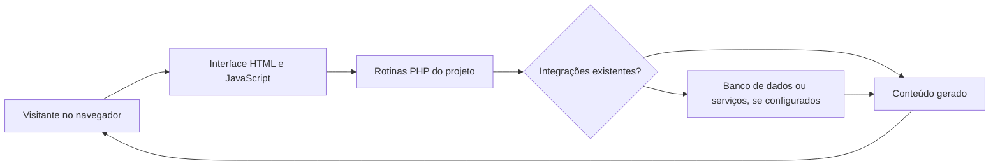

# osti

**Projeto histórico do acervo Casa da Web (2003–2011).** Esta pasta corresponde ao diretório original `osti`, preservado como unidade de catalogação.

> A catalogação é baseada em nomes de arquivos e extensões encontrados nos ZIPs. Módulos indicados abaixo são **indícios**, não funcionalidades testadas ou promessas de funcionamento.

## Inventário

| Indicador | Quantidade |
|---|---:|
| Arquivos | 722 |
| Tamanho descompactado aproximado | 25.8 MiB |
| PHP | 119 |
| ASP Clássico | 11 |
| HTML/HTM | 69 |
| JavaScript | 145 |
| CSS | 20 |
| Flash SWF / FLA | 0 / 0 |

**Tecnologias identificadas:** PHP, ASP Clássico, HTML, CSS, JavaScript, ColdFusion, Python.

## Módulos identificados preliminarmente

- Área administrativa (indício pelo nome de arquivos)
- Relatórios (indício pelo nome de arquivos)
- Áudio e streaming (indício pelo nome de arquivos)

## Fluxo técnico referencial

O fluxograma representa apenas uma **estrutura técnica possível**, não uma arquitetura de produção auditada.

## Código-fonte

Os fontes históricos serão incorporados em `src/` **depois de revisar credenciais, bancos de dados, dados de terceiros e direitos de distribuição**. A cópia pública não deve conter dados operacionais antigos.

## Estado

- [x] Pastas e tecnologias inventariadas
- [ ] Revisão manual de arquivos potencialmente sensíveis
- [ ] Publicação dos fontes selecionados e revisados
- [ ] Testes de execução no ambiente legado
